# GXW Launcher — скриншоты

Актуальная версия: **0.3.2 «Фон и порядок»**.

## 0.3.2 — Фон и порядок

### Окно обновления

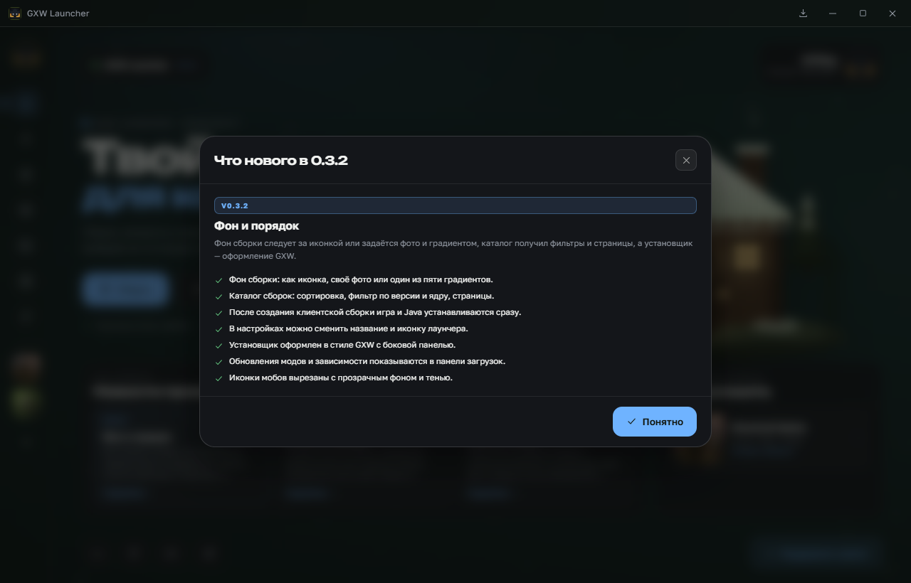

### Фон сборки

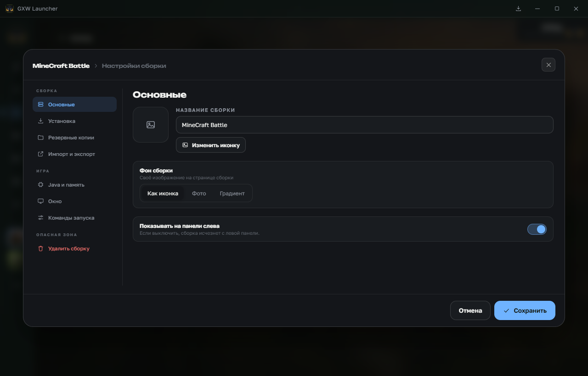

### Фильтры каталога

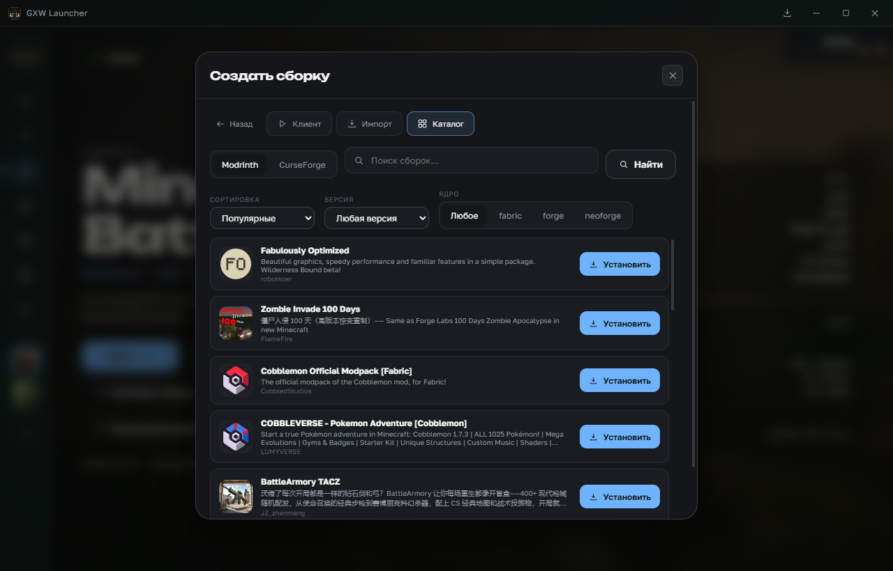

### Название и иконка лаунчера

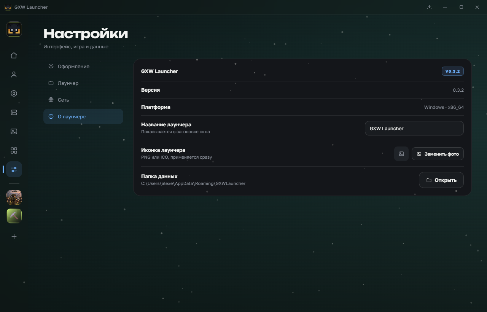

### Установщик

Приветствие:

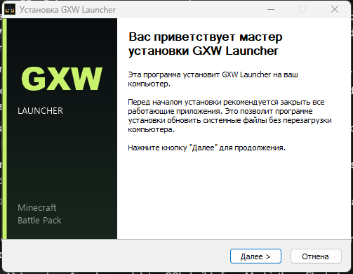

Уже установлено:

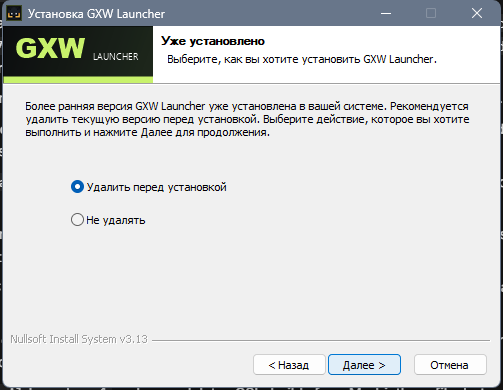

Папка установки:

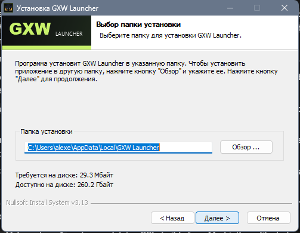

Копирование файлов:

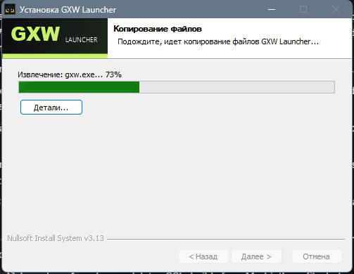

Завершение:

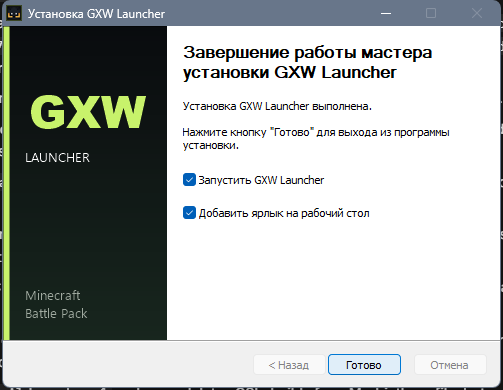

### Иконки сборок

Выбор иконки при создании сборки:

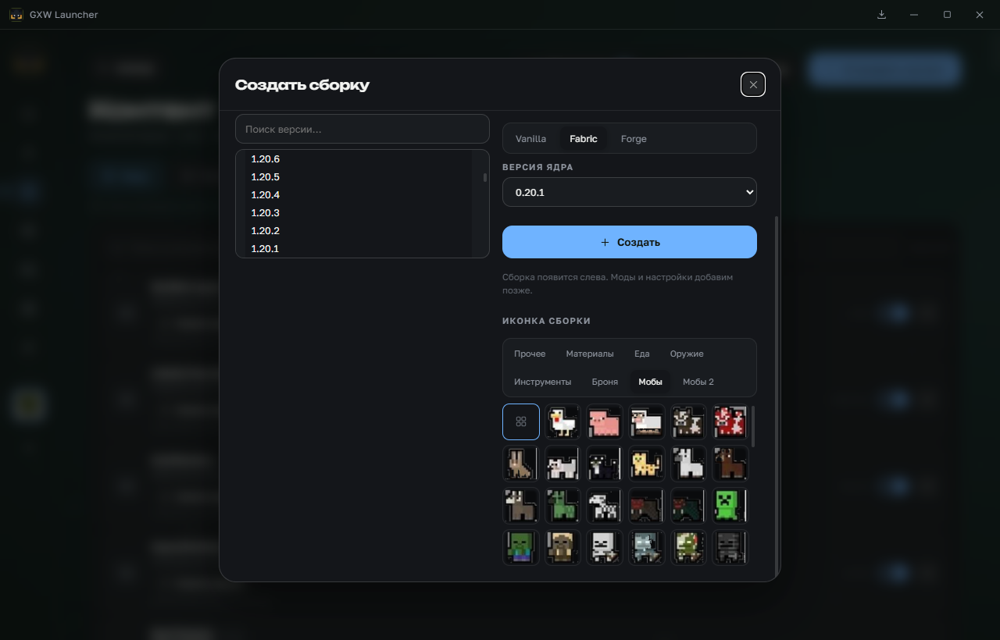

Редактор иконок с готовыми наборами:

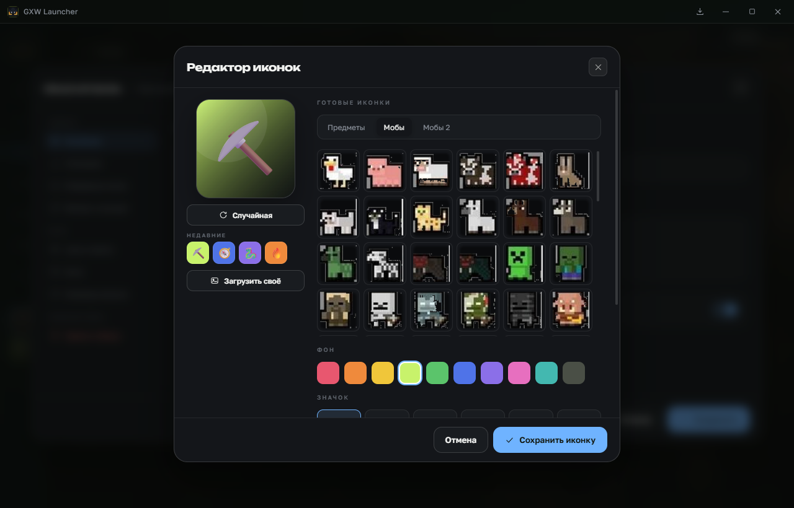
