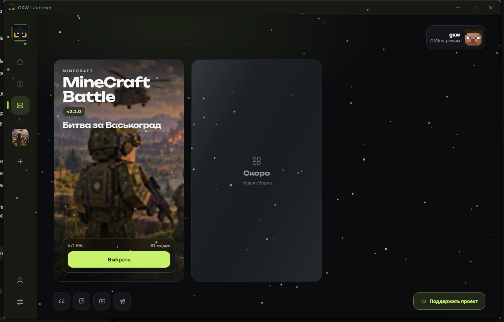

# GXW Launcher 0.1.9 — скриншоты

Скриншоты собраны с релизной версии 0.1.9.

## Главный экран

## Экран сборки

Карточка сервера и список модов убраны. Добавлены «Контент» и компактная карточка «О сборке».

## Контент — моды

91 установленный мод с переключателями. Каталог Modrinth отфильтрован под 1.20.1 Forge.

## Контент — текстуры

## Контент — шейдеры

## CurseForge без ключа

## Выбор версии мода

## Настройки сборки

Смена названия, загрузка иконки, память, Java, разрешение, IP.

## Параметры JVM и игры

## CurseForge API в настройках лаунчера

